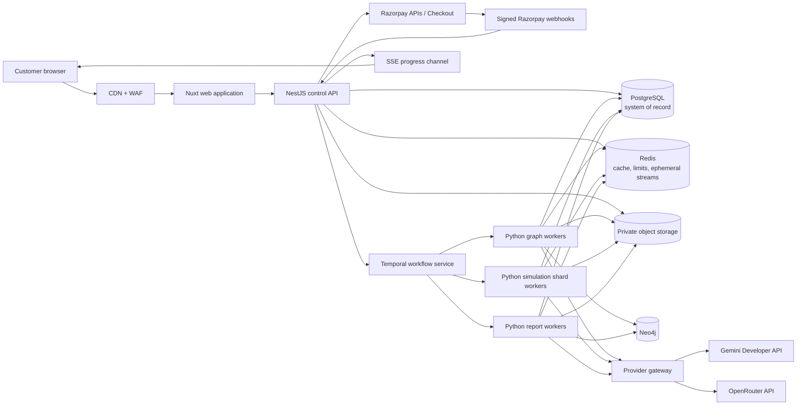
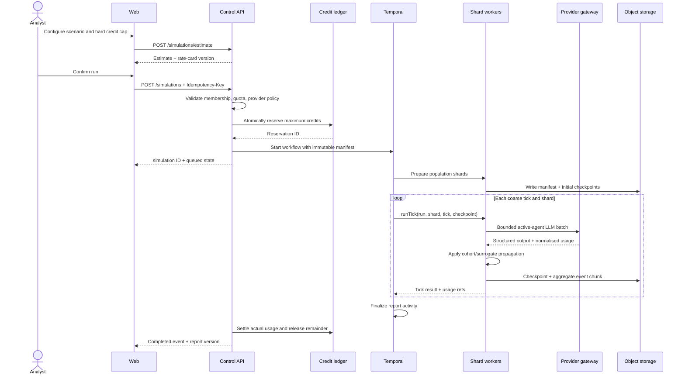

# CrowdLens — Technical Architecture

**Document:** `architecture.md`  
**Status:** v1.0 — target architecture and migration plan  
**Date:** 2026-11-09  
**Companion documents:** `specs.md`, `design.md`, `instructions.md`

## 1. Architectural intent

CrowdLens separates a **multi-tenant commercial control plane** from a **durable simulation data plane**. The existing MiroFish-Offline graph and simulation knowledge is preserved behind ports/adapters, while local files, process globals, and singleton provider configuration are replaced by durable, tenant-scoped infrastructure.

The architecture optimises for:

- Safe multi-tenancy and auditability.
- Durable, resumable simulations and exactly-once ledger effects.
- Provider choice without changing historical run meaning.
- Predictable unit economics under variable LLM cost.
- Horizontal scale to millions of lightweight logical agents.
- Cache efficiency without stale entitlements, data leaks, or false reproducibility.
- Incremental migration rather than a risky big-bang rewrite.

### 1.1 Key constraints

1. A million logical agents cannot mean a million LLM calls per tick.
2. Redis is a derived-data system, never the source of truth.
3. Temporal/workflow history cannot contain the full agent event firehose.
4. Provider and embedding choices are part of data lineage.
5. Every background job re-establishes tenant and authorisation context.
6. Browser payment success is not billing proof.
7. AGPL obligations are a release requirement for the covered modified work.

## 2. System context



### 2.1 Control plane vs data plane

| Control plane | Simulation data plane |
|---|---|
| Identity, workspace, RBAC | Document parsing and graph extraction |
| Projects and run configuration | Population generation and shard state |
| Provider policies and secret references | Active-agent reasoning and cohort updates |
| Plans, entitlements, credit ledger | Checkpoints and event aggregation |
| Reports, shares, exports | Report evidence collection and interviews |
| Cache orchestration and audit | Content-addressed artifact creation |
| Operational controls | Cost/token/performance telemetry |

The control plane never performs long LLM or simulation work inside an HTTP request. Data-plane workers never decide billing entitlements from client input; they consume an authorised, immutable run manifest.

## 3. Technology decisions

| Concern | Decision | Reason |
|---|---|---|
| Web | Nuxt, Vue 3, TypeScript | Preserves existing Vue knowledge/components; supports SSR landing and authenticated app. |
| Control API | NestJS, TypeScript | Modular boundaries, validation, testability, and strong integration ecosystem. |
| Simulation | Python 3.11+ workers | Retains MiroFish/OASIS services, Neo4j code, data tooling, and Pydantic. |
| Workflow | Temporal | Durable retries, heartbeats, cancellation, timers, and coarse shard orchestration. |
| Transactional data | PostgreSQL | Tenancy, RLS, constraints, ledger transactions, outbox, and audit. |
| Graph | Neo4j behind expanded `GraphStorage` | Preserves the existing abstraction and hybrid-search approach. |
| Cache/ephemeral | Redis | Versioned cache, single-flight, rate limits, idempotency acceleration, short-lived streams. |
| Artifacts | S3-compatible private object storage | Originals, parsed chunks, personas, checkpoints, event chunks, and exports. |
| Analytics at scale | ClickHouse, introduced on measured need | High-volume event/usage analysis without burdening PostgreSQL. |
| Contracts | JSON Schema source + generated TS/Pydantic types | Prevents provider/API boundary drift. |
| Deployment | Containers; managed stateful services preferred | Long-running workers remain off request-only serverless platforms. |

No per-agent Temporal activity, Kafka cluster, microservice-per-stage, or analytical database is required on day one. Add them only when measured scale demands them.

## 4. Target repository layout

```text
crowdlens/
├─ apps/
│  ├─ web/                       # Nuxt landing + authenticated application
│  └─ control-api/               # NestJS modules, REST, SSE, webhooks
├─ services/
│  ├─ graph-worker/              # Python document/graph workflows
│  ├─ simulation-worker/         # Python population and shard workflows
│  └─ report-worker/             # Python reports and agent interviews
├─ packages/
│  ├─ contracts/                 # JSON Schema and generated contracts
│  ├─ ui/                        # Vue design system
│  ├─ config/                    # Shared lint/test/build configuration
│  └─ observability/             # Logging, tracing, redaction helpers
├─ legacy/
│  └─ mirofish-offline/          # Upstream baseline, notices, migration reference
├─ infra/
│  ├─ compose/                   # Local dependencies
│  ├─ migrations/                # PostgreSQL migrations
│  └─ policies/                  # Bucket, network, retention examples
├─ tests/
│  ├─ fixtures/
│  ├─ integration/
│  ├─ tenancy/
│  └─ scale/
├─ specs.md
├─ design.md
├─ architecture.md
└─ instructions.md
```

The exact package manager and versions are locked at scaffold time. Do not mix npm, pnpm, and yarn lockfiles.

## 5. Migration from MiroFish-Offline

| Existing component | Migration action | Target |
|---|---|---|
| Vue views/components | Convert incrementally to TypeScript; preserve D3 graph work where suitable | `apps/web` |
| Flask graph/report/simulation blueprints | Replace public routes with control API; extract service calls into worker activities | NestJS + Python workers |
| `LLMClient` | Replace global `Config` with request-scoped provider manifest and usage-rich adapter result | `ProviderGateway` |
| `ProjectManager` JSON files | Map metadata to PostgreSQL; original files to object storage | Projects/documents modules |
| `TaskManager` in-memory state | Durable workflows plus persisted run/stage status | Temporal + run tables |
| Local simulation directories | Immutable run prefixes and checkpoints in private object storage | Artifact service |
| `SimulationManager` | Split preparation, run manifest, and execution; remove process-global authority | Population/orchestrator services |
| OASIS runner scripts | Retain as active-reasoning backend behind an execution port | Active reasoner adapter |
| Neo4j `GraphStorage` | Require tenant/project context in every method; version embeddings | Graph worker/storage |
| Wildcard CORS/default secrets/request-body logs | Remove; add origin allowlist, secret manager, structured redaction | Platform baseline |

### 5.1 Strangler sequence

1. Import upstream with licence history and commit provenance.
2. Characterise existing document → graph → simulation → report behaviour with golden fixtures.
3. Introduce tenant-aware repositories and artifact storage around existing services.
4. Introduce the provider port and adapt the existing Ollama client as a development-only provider.
5. Move execution into durable activities while keeping the old API as an internal compatibility facade temporarily.
6. Migrate frontend routes to workspace-scoped routes.
7. Add billing/ledger/entitlements and cache invalidation.
8. Remove public Flask routes, local file authority, wildcard CORS, and old in-memory task state.
9. Add the distributed population kernel only after the single-run path is correct.

## 6. Domain model and tenancy

### 6.1 Core PostgreSQL entities

| Entity | Purpose | Important fields/constraints |
|---|---|---|
| `users` | Identity mapping | OIDC subject unique; no workspace-owned passwords |
| `workspaces` | Tenant root | slug, status, data policy, billing version |
| `memberships` | User/workspace/role | unique `(workspace_id, user_id)` |
| `projects` | Scenario container | `(workspace_id, id)` PK; status/version |
| `documents` | Original and parse metadata | content hash, object key, parser version |
| `graphs` | Graph lineage | embedding profile, schema version, source set hash |
| `provider_configs` | Workspace policy | provider, allowlist, secret reference, encrypted BYOK metadata |
| `simulations` | Immutable run manifest + mutable status projection | config hash, provider snapshot, seed, rate-card version |
| `simulation_shards` | Shard progress | shard index, tick, checkpoint key, heartbeat |
| `usage_records` | Provider/work usage | tokens, cached tokens, duration, actual/estimated flag |
| `reports` | Immutable report versions | content hash, object key, evidence manifest |
| `report_shares` | Revocable public capability | token hash, expiry, scope, revoked time |
| `plans` / `subscriptions` | Commercial entitlement | Razorpay IDs, state, period boundaries, version |
| `wallets` | Credit projection/version | workspace unique; never sole balance proof |
| `credit_ledger_entries` | Immutable credit movements | amount, type, idempotency key unique |
| `credit_reservations` | Active/settled/released holds | simulation unique, maximum credits |
| `webhook_events` | Durable inbox | provider event key/hash unique, raw payload protected |
| `outbox_events` | Reliable domain-event publication | aggregate, type, payload, published time |
| `audit_logs` | Append-only security/business audit | actor, action, target, request ID |
| `cache_versions` | Coherent invalidation generations | workspace/scope/version |

All tenant-owned tables use `(workspace_id, id)` or an equivalent tenant-first uniqueness/foreign-key strategy. Internal worker tables that contain no tenant data still reference the owning run/workspace for lifecycle and audit.

### 6.2 Tenant enforcement

- API derives workspace from the verified session and membership; route IDs alone are not proof.
- Each PostgreSQL transaction sets `SET LOCAL app.workspace_id = '<verified uuid>'`.
- RLS policies check `workspace_id = current_setting('app.workspace_id')::uuid` for tenant tables.
- The application database role must not bypass RLS. Migration roles are separate.
- Worker payloads contain workspace/run IDs but workers still verify the run’s persisted state and authorisation epoch.
- Membership/provider/billing changes increment an `authz_epoch`; stale jobs stop before paid work.
- Neo4j nodes and relationships carry `workspace_id` and `project_id`; all queries require them and use parameterised Cypher.
- Object keys begin `tenant/<workspace_uuid>/...`; signed URLs are generated only after authorisation.
- Redis keys include a tenant hash and ACL/version scope; values never serve as an authorisation source.
- Logs use random request/run correlation IDs. Avoid source text, secrets, and unnecessary personal data.

### 6.3 Enterprise isolation

A dedicated enterprise deployment may use separate worker queues, object buckets, and Neo4j infrastructure. Do not assume Neo4j Community Edition provides the same multi-database operational model as commercial editions.

## 7. API and event contracts

### 7.1 External REST surface

```text
POST   /v1/projects
POST   /v1/projects/:id/documents/init
POST   /v1/documents/:id/complete
POST   /v1/projects/:id/graph/build
GET    /v1/projects/:id

POST   /v1/simulations/estimate
POST   /v1/simulations
GET    /v1/simulations/:id
POST   /v1/simulations/:id/cancel
POST   /v1/simulations/:id/clone
GET    /v1/simulations/:id/events        # SSE, Last-Event-ID capable

GET    /v1/reports/:id
POST   /v1/reports/:id/shares
DELETE /v1/report-shares/:id
POST   /v1/reports/:id/interviews

GET    /v1/providers/catalog
PUT    /v1/workspaces/:id/provider-defaults
POST   /v1/provider-configs/validate

POST   /v1/billing/subscriptions
POST   /v1/billing/subscriptions/:id/cancel
POST   /v1/billing/credit-packs
GET    /v1/billing/usage
POST   /v1/webhooks/razorpay             # raw-body route, no tenant session
```

Mutation APIs accept `Idempotency-Key`. Responses use a shared problem-details error format. Lists use cursor pagination. Run creation, estimation, and credit settlement are separate operations so users can inspect cost before commitment.

### 7.2 Domain-event envelope

```json
{
  "event_id": "uuid",
  "event_type": "simulation.stage.completed",
  "event_version": 1,
  "occurred_at": "RFC3339 timestamp",
  "workspace_id": "uuid",
  "aggregate_id": "simulation uuid",
  "correlation_id": "request uuid",
  "causation_id": "workflow/activity uuid",
  "payload": {}
}
```

PostgreSQL outbox events are authoritative for business effects. Redis Streams/SSE are ephemeral delivery optimisations; clients can recover through polling. High-volume agent events use chunked object artifacts and aggregate tables rather than the domain outbox.

## 8. Durable simulation workflow



### 8.1 Workflow rules

- Workflow activities are coarse: build a graph chunk batch, prepare a shard, execute a shard tick, aggregate a tick, or generate a report section.
- Activity input contains IDs and immutable artifact references, not large payloads.
- Every activity has timeout, heartbeat, retry, and idempotent output naming.
- External provider retries use exponential backoff with jitter and a maximum elapsed budget.
- Credit usage is posted from durable usage records with unique `(activity_attempt, usage_type)` semantics.
- Cancellation checkpoints occur between LLM batches and before shard checkpoint writes.
- Non-deterministic provider output never enters Temporal workflow replay logic directly; it is stored as activity output/artifact.
- Run provider/model/rate-card manifests are immutable. Retry uses the same manifest.

## 9. Million-logical-agent data plane

### 9.1 Hybrid population kernel

CrowdLens uses three levels of computation:

1. **Population state:** compact attributes and state arrays for every logical agent.
2. **Cohort/surrogate transitions:** deterministic/stochastic updates for agents not directly reasoned in a tick.
3. **Active reasoning:** direct structured LLM interactions for a bounded representative subset.

The existing OASIS path is an active-reasoning backend, not presumed to be a million-agent population store.

### 9.2 State representation

- Generate persona batches to compressed JSON/Parquet artifacts.
- Use columnar state (Arrow/Parquet; NumPy/Polars where useful) for stance, activity, fatigue, influence, cohort, and last-update tick.
- Export relevant Neo4j communities/adjacency into shard snapshots.
- Keep detailed text memory only for active agents; store compact memory references for the rest.
- Partition by community while balancing shard size and cross-shard edge ratio.
- Use a documented deterministic PRNG stream keyed by run seed, shard, tick, and agent ID.

### 9.3 Tick pipeline

```text
load checkpoint
  → ingest external/source events
  → score agent activation candidates
  → stratified active-agent selection
  → bounded structured LLM batches
  → validate and persist direct actions
  → propagate aggregate effects to cohorts/neighbours
  → apply stochastic state transitions
  → compute segment/shard aggregates
  → reconcile cross-shard boundary events
  → write atomic checkpoint + usage records
```

A global tick is a bulk-synchronous barrier for reproducibility. Cross-shard actions affect the next tick unless a documented algorithm says otherwise.

### 9.4 Active-agent selection

Selection combines:

- Segment and persona coverage.
- Network influence and bridge positions.
- Novel/controversial content involvement.
- Previous stance-change magnitude.
- Random stratified sampling to avoid only hearing extreme voices.

Selection rules and active count are recorded. Inactive-agent statements are never presented as direct LLM testimony.

### 9.5 Checkpoint and event storage

```text
tenant/<workspace>/runs/<run>/
  manifest.json
  population/profiles-<batch>.parquet
  shards/<shard>/checkpoint-<tick>.parquet
  shards/<shard>/events-<tick>-<part>.jsonl.zst
  aggregates/<tick>.json
  reports/<version>/report.json
  reports/<version>/evidence.json
```

Checkpoint writes use temporary keys, checksums, and atomic manifest promotion. A run loads only the last complete checkpoint. Raw events are sampled/aggregated for UI and may have shorter retention than reports.

### 9.6 Calibration and honesty

- Replay historical events and compare direction/distribution where ground truth exists.
- Run multiple seeds and publish sensitivity ranges.
- Maintain a benchmark set by scenario class.
- Do not expose a single “probability of public reaction” without method and interval.
- Mark cohort-derived details as `surrogate_inferred`; direct outputs as `llm_generated`; source facts as `source_backed`.

## 10. AI provider gateway

### 10.1 Port

```python
class ProviderGateway(Protocol):
    async def generate_structured(
        self,
        request: StructuredGenerationRequest,
        context: ProviderCallContext,
    ) -> StructuredGenerationResult: ...

    async def generate_text(
        self,
        request: TextGenerationRequest,
        context: ProviderCallContext,
    ) -> TextGenerationResult: ...

    async def health_check(
        self,
        config: ResolvedProviderConfig,
    ) -> ProviderHealth: ...
```

`StructuredGenerationResult` includes parsed data, provider/model/endpoint, request ID, latency, retries, token usage, cached-token usage, cost evidence, cache metadata, and raw-response artifact reference. Embeddings use a separate `EmbeddingGateway` and `embedding_profile_id`.

### 10.2 Run manifest snapshot

```json
{
  "provider": "gemini | openrouter",
  "model_id": "server-catalog-id",
  "model_revision": "catalog-snapshot-hash",
  "prompt_bundle_version": "semver/git-sha",
  "structured_schema_version": "schema-hash",
  "embedding_profile_id": "immutable-profile-id",
  "routing_policy": {},
  "random_seed": 12345,
  "rate_card_version": "credits-2026-11-09"
}
```

### 10.3 Gemini adapter

- Use the official Google GenAI SDK for the selected Gemini API surface.
- Label the UI “Gemini (AI Studio key)”; AI Studio is credential/model experimentation tooling, not another provider.
- Request structured output where the selected model/API supports it; still validate locally.
- Keep stable instructions and large reusable source material at the prefix; dynamic tick/persona content goes last.
- Use implicit caching opportunistically. Use explicit cache objects only when the selected API/model supports them and expected reuse justifies write/storage cost.
- Store explicit cache handles with provider expiry and model binding; expire local mappings earlier than upstream expiry and tolerate provider misses.
- Record cached tokens and actual usage when returned.

### 10.4 OpenRouter adapter

- Use the official SDK or supported OpenAI-compatible API contract.
- Use strict JSON Schema for compatible endpoints and set `provider.require_parameters = true`.
- Configure `data_collection: "deny"` by default where required by product policy; enterprise ZDR policy sets `zdr: true`. If no eligible endpoint exists, fail configuration before charging for a run rather than silently relaxing policy.
- Same-model endpoint fallback may remain enabled. Manual provider order and cross-model fallback are explicit admin policy, not accidental defaults.
- Supply a random, non-PII `session_id` for a stable agent conversation or prompt family to improve sticky routing/cache warmth.
- Record provider, model, endpoint where available, cached tokens, cache discount, and generation ID for reconciliation.
- Do not assume strict output is equally enforced on every endpoint; local schema validation remains mandatory.

### 10.5 Failure and switching policy

- A run does not silently switch Gemini ↔ OpenRouter after starting.
- Retry the snapshotted route within bounded policy.
- On unrecoverable failure, checkpoint and mark the stage failed/retryable.
- User may clone from a valid checkpoint with a new provider, producing a new run lineage and estimate.
- Any authorised exceptional failover creates a new manifest revision, audit entry, report disclosure, and cost reservation; it is never a hidden retry.

## 11. Billing and credit-ledger architecture

### 11.1 Payment flows

**Subscription:** backend creates/fetches Razorpay customer and subscription → hosted Checkout → signed webhook/API verification → subscription projection + plan grant → entitlement/cache invalidation.

**Credit pack:** backend creates internal purchase + Razorpay order with amount/currency from server catalog → Checkout → `order.paid`/payment verification → exactly-once top-up grant → entitlement/cache invalidation.

Webhook requirements:

1. Read raw bytes before JSON parsing.
2. Validate `X-Razorpay-Signature` using the webhook secret and HMAC-SHA256 with constant-time comparison.
3. Persist the event/inbox record before returning 2xx.
4. Deduplicate using Razorpay’s event identifier when supplied; otherwise use a documented deterministic hash of raw payload/event/entity identifiers.
5. Process asynchronously in a transaction; handle at-least-once and out-of-order delivery.
6. Fetch current Razorpay state when an event appears stale or critical status needs confirmation.
7. Post ledger and outbox effects in the same PostgreSQL transaction.
8. Reconcile daily against subscriptions, orders, payments, and ledger entries.

### 11.2 Credit accounting

Use integer credits and immutable entries. Available balance is conceptually:

```text
sum(grants + releases + positive adjustments)
- sum(usage_debits + expirations + negative adjustments)
- sum(active_reservations)
```

The creation transaction:

- Locks the wallet row or uses a serialisable equivalent.
- Re-reads active holds and available credits.
- Inserts simulation, reservation, ledger entry, workflow/outbox reference, and audit event.
- Enforces unique idempotency key and non-negative available balance.
- Only then starts the workflow.

Settlement is idempotent per run and consumes durable usage records. Reservation release and final debit are one transaction. Abandoned runs are detected by reconciliation and settled/released according to actual durable work, never blindly expired into free usage.

## 12. Caching architecture

### 12.1 Cache layers

| Layer | Cached content | Policy |
|---|---|---|
| CDN | Static JS/CSS/fonts/images, public sample artifacts | Hashed assets `public,max-age=31536000,immutable`; HTML revalidated/network-first. |
| Browser | Session query data and UI preferences | In-memory query cache by workspace; no sensitive shared localStorage cache. |
| HTTP | Private report/project responses | `private` ETag/`Cache-Control:no-cache` where useful; never shared CDN caching by default. |
| Redis | Entitlements, catalogs, lists, graph queries, idempotency, short progress projections | Versioned tenant keys and explicit TTL/invalidation. |
| Artifact store | Parses, graph batches, personas, checkpoints, immutable reports | Content-addressed with lineage and retention; not an uncontrolled response cache. |
| Provider | Gemini/OpenRouter prompt caching | Best-effort cost optimisation; correctness never depends on a hit. |

### 12.2 Key grammar and fingerprint

```text
cl:<schema_version>:<tenant_hash>:<scope_hash>:<operation>:<fingerprint>
```

`fingerprint = SHA-256(canonical_json(normalised_input))`

Canonical input includes only semantics, in stable key order, plus all relevant versions:

```json
{
  "workspace_id": "uuid — hashed into key material, not exposed in logs",
  "acl_epoch": 17,
  "operation_version": "ner-v3",
  "provider": "gemini",
  "model_id": "catalog-model-id",
  "prompt_bundle": "git-sha",
  "schema_hash": "sha256",
  "source_hashes": ["sha256"],
  "parameters": {},
  "random_seed": "included only when part of semantics"
}
```

No raw email, document title, prompt, source text, provider key, or Razorpay identifier appears in metric labels or publicly visible cache metadata.

### 12.3 Redis cache matrix

| Operation | Example scope/fingerprint | TTL | Invalidation | Notes |
|---|---|---:|---|---|
| Provider catalog | global + catalog source + allowlist hash | 5 min | Admin refresh/model policy event | Safe stale-while-revalidate. |
| Workspace provider defaults | tenant + provider config version | 60 s | Provider-settings event | Values exclude plaintext secrets. |
| Entitlement projection | tenant + billing version + authz epoch | 30 s | Payment/subscription/adjustment event | DB remains authoritative for reservation. |
| Project list | tenant + user/ACL + filters + cursor + project version | 30–60 s | Project change bumps generation | Never key only by user without tenant. |
| Project detail | tenant + ACL + project ID + entity version | 60 s | Write-through/version bump | Authorisation checked before cache read. |
| Run live status | tenant + ACL + run ID | 0–2 s | Durable status event | Prefer SSE/polling recovery, not long TTL. |
| Final report metadata | tenant + ACL + report version | 24 h | Share/ACL revocation bumps scope | Report content immutable. |
| Public share | share-token hash + share version | ≤60 s | Immediate delete + version bump on revoke | Cache negative result after revocation. |
| Graph hybrid search | tenant + ACL + graph/embedding versions + query hash | 15–60 min | Graph build or ACL change | Results re-authorised before return. |
| Exact safe LLM task | full semantic fingerprint | 1–24 h | Prompt/model/schema/source version | Only deterministic/idempotent task classes. |
| Idempotency record | tenant + actor + route + idempotency key | 24 h or business window | Natural expiry | DB uniqueness remains final guard. |
| Rate limit/cost circuit | tenant + operation + time bucket | Bucket expiry | None | Atomic increments; bounded fallback if Redis fails. |
| Single-flight lease | same operation fingerprint | Short lease | Owner release/watchdog | Prevents stampedes; not a distributed correctness lock for billing. |

TTLs are launch defaults to tune from measurements. They are not a substitute for event invalidation.

### 12.4 Artifact reuse matrix

| Artifact | Reuse key | Cross-project reuse | Cross-tenant reuse |
|---|---|---|---|
| Parsed document | file SHA-256 + parser/OCR version + options | Yes, same tenant and authorised source | No shared readable result; optional deduplicated encrypted storage only after privacy review |
| Ontology/extraction | source chunk hash + ontology/prompt/model/schema versions | Yes | No |
| Embedding batch | chunk hash + embedding model/profile version | Yes, within compatible graph profile | No |
| Persona batch | population algorithm + source/entity set + seed + model/prompt versions | Yes when explicitly cloned | No |
| Simulation checkpoint | full run manifest + parent checkpoint + tick | Same run lineage only | Never |
| Final report | run/result/evidence + report prompt/model/version | Immutable version reference | Never |
| Export | report version + format + export code version | Same authorised report | Never |

### 12.5 Cache-aside with single-flight

```text
authorise request using database/session context
key = versioned_tenant_fingerprint(request, acl_epoch)
if fresh authorised cache entry exists:
    return entry

lease = try_acquire_single_flight(key, short_lease)
if lease not acquired:
    wait briefly, re-read cache, or compute bounded local fallback

try:
    value = load_from_source_of_truth()
    authorise_and_validate(value)
    write_cache(key, value, ttl)
    return value
finally:
    release_owned_lease(lease)
```

For billing reservation, ledger settlement, membership revocation, and payment grants, bypass cache-aside and use database transactions. Single-flight never replaces transactional correctness.

### 12.6 Invalidation

Prefer **generation bumps** over broad key scans or `FLUSHDB`:

1. Domain transaction updates source data and increments `cache_versions` or entity version.
2. Same transaction writes outbox event.
3. Publisher emits invalidation event.
4. New reads use the new generation; old keys expire naturally.
5. Security-sensitive revocations additionally delete known share/session keys and close SSE channels.

Never depend on Redis keyspace notifications for correctness. Avoid deleting millions of keys synchronously. Track invalidation lag as a metric.

### 12.7 LLM response caching rules

Eligible initially:

- Repeated NER/relationship extraction for identical chunks.
- Repeated deterministic document classification.
- Identical embedding requests within a versioned profile.
- Stable report formatting only if its complete evidence input is unchanged.

Not eligible by default:

- Stochastic persona variation without an explicit seed/policy.
- Ordinary agent ticks, because reusing one response can distort emergent behaviour.
- Interviews containing evolving run state.
- Any semantic/similarity cache shared across tenants.
- Requests whose provider, model, tools, schema, prompt version, data policy, or source hashes differ.

A semantic cache may later be enabled per workspace for read-only support tasks after privacy and evaluation review. It must never drive simulation state by default.

### 12.8 Prompt caching

- Place shared system instructions, tool declarations, ontology, and large source context in stable prefixes.
- Put run/tick/persona/question variability in suffixes.
- Do not insert timestamps, random request IDs, or unstable ordering into reusable prefixes.
- Treat Gemini implicit caching and OpenRouter sticky/provider caching as best-effort; a miss returns a normal correct response.
- Track cached input tokens and cache-write cost where exposed. A cache is useful only if total cost/latency improves.
- Do not reuse provider cache handles across model, workspace, or data-policy boundaries.

### 12.9 HTTP/CDN policy

| Response | Cache-Control guidance |
|---|---|
| Fingerprinted static asset | `public, max-age=31536000, immutable` |
| Landing HTML | `public, max-age=0, must-revalidate` or CDN equivalent network-first |
| Authenticated API | `private, no-store` by default; selective ETag with `no-cache` |
| Final report JSON | `private, no-cache` + ETag; re-authorise on revalidation |
| Public share | `private, no-store` unless a dedicated revocation-safe public cache is built |
| Signed object redirect | `private, no-store`; underlying object URL short-lived |
| Webhook | `no-store` |

Service workers, if added, must not cache authenticated API, report shares, webhooks, or HTML navigations cache-first.

### 12.10 Cache failure behaviour

- Redis read/write failure: fall back to the source of truth for ordinary reads with bounded concurrency.
- Redis unavailable during run creation: database reservation still decides; do not grant free extra capacity from an obsolete cached balance.
- Redis stream failure: clients poll durable run status.
- Provider cache miss/expiry: regenerate normally.
- Artifact checksum mismatch: quarantine, rebuild from source, and emit an alert.
- Cache poisoning/authorisation uncertainty: bypass and revalidate; never “fail open” on access.

### 12.11 Cache observability and tests

Metrics by operation/model class only, not by tenant:

- Hit/miss/bypass ratio, single-flight joins, lock contention.
- Source latency vs cache latency.
- Invalidation lag and stale-authorisation rejections.
- Exact/artifact reuse savings and provider cached-token share.
- Redis memory, evictions, key size, hot keys, and connection saturation.
- Estimate-vs-actual provider savings.

Required tests:

1. Same input/same tenant hits; different tenant misses.
2. ACL revocation/member removal misses or rejects immediately.
3. Provider/model/prompt/schema/source/seed changes miss.
4. Billing webhook changes entitlement generation and cannot reuse stale credit balance.
5. Share revocation cannot be undone by a cached 200 response.
6. Worker retry reuses idempotent artifact without duplicate ledger effects.
7. Redis downtime does not corrupt state or expose data.
8. Provider cache expiry is transparent.
9. Canonical JSON serialisation produces stable fingerprints across TypeScript and Python.
10. Deletion removes or makes inaccessible every cached derivative.

## 13. Report evidence model

Each material report claim has a provenance array:

```json
{
  "claim_id": "clm_...",
  "text": "Segment A increasingly questions implementation cost.",
  "confidence_label": "exploratory",
  "evidence": [
    {"type": "source_chunk", "id": "doc/chunk", "relation": "context"},
    {"type": "event_aggregate", "id": "run/tick/segment", "relation": "supports"},
    {"type": "active_agent_response", "id": "response-artifact", "relation": "example"}
  ],
  "method": "llm_generated_synthesis"
}
```

Unsupported or contradictory evidence is surfaced. A fluent narrative cannot upgrade synthetic events into real-world facts. Report versions include model, prompt, run seed, population method, active/surrogate ratio, and limitations.

## 14. Security architecture

### 14.1 Trust boundaries

- Browser ↔ CDN/WAF ↔ web/API.
- API ↔ PostgreSQL/Redis/Neo4j/object storage.
- API/workers ↔ Temporal.
- Workers ↔ external model providers.
- Razorpay ↔ public webhook endpoint.
- Public share token ↔ minimal read-only report projection.

### 14.2 Controls

- TLS everywhere; managed encryption at rest.
- Managed secret store and rotation; BYOK envelope encryption.
- OIDC/PKCE and secure, rotated server sessions.
- Strict CORS origins and CSRF protection for cookie mutations.
- Schema validation and output encoding; parameterised SQL/Cypher.
- Parser sandbox, file-size limits, malware scanning, and active-content stripping.
- Prompt-injection separation: source text is quoted data; tools are allowlisted; no arbitrary URLs/code execution from agent output.
- Rate limits by identity, workspace, IP risk, and expensive operation.
- Short-lived signed URLs and scoped share tokens stored as hashes.
- Append-only audit and tamper-evident billing exports.
- Backup/restore and tenant-deletion workflows tested regularly.

## 15. Observability and operations

### 15.1 Telemetry

- OpenTelemetry traces across API, workflow, activity, provider, and settlement.
- Structured logs with request/run/activity IDs and redaction.
- Dashboards for API SLOs, queue depth, shard lag, provider errors, token cost, webhook inbox, ledger anomalies, cache health, and storage growth.
- Alerts on repeated provider 429/5xx, stalled heartbeats, negative-balance attempts, webhook backlog, invalidation lag, and unusually expensive runs.

### 15.2 Operator controls

- Pause new runs globally, per provider, or per workspace.
- Drain worker pools and resume from checkpoints.
- Replay a webhook from durable inbox without duplicating effects.
- Reconcile provider/payment/credit records.
- Invalidate a cache generation without flushing the service.
- Revoke shares/sessions and rotate provider secrets.
- Apply model allowlists and cost ceilings.

## 16. Deployment and scaling

### 16.1 Environments

- **Local:** Docker Compose for PostgreSQL, Neo4j, Redis, object storage, and Temporal; mocked Razorpay/provider servers in tests.
- **Staging:** production-like managed services, Razorpay test mode, provider budget caps, synthetic tenancy/load tests.
- **Production:** separate accounts/projects, secrets, buckets, databases, webhook secrets, and model keys. No shared test/live identifiers.

### 16.2 Initial production topology

- CDN/WAF and Nuxt web deployment.
- At least two control API instances.
- Separate graph, simulation, and report worker autoscaling groups.
- Temporal service with persistence suitable for production.
- Managed PostgreSQL with PITR, HA Redis, private Neo4j, and versioned object storage.
- Single primary region initially; regional data residency is an enterprise architecture variant, not a claim of default deployment.

### 16.3 Scaling triggers

| Signal | Action |
|---|---|
| API p95/CPU saturation | Scale API; inspect N+1 and cache hit rates before adding complexity. |
| Workflow backlog | Scale the correct worker pool; enforce tenant fairness and concurrency. |
| Neo4j query pressure | Optimise indexes/snapshots; isolate enterprise graph workload. |
| PostgreSQL event/usage growth | Partition tables and introduce analytical storage on measured need. |
| Redis hot keys/evictions | Shard by operation, shorten payloads, and use artifact storage. |
| Cross-shard tick skew | Rebalance communities or reduce global barrier frequency with algorithm review. |
| Provider 429/cost ceiling | Reduce active reasoning, route within policy, queue fairly, or reject over-budget work. |

## 17. Reliability and disaster recovery

- PostgreSQL point-in-time recovery and object-storage versioning.
- Temporal persistence backed up according to vendor guidance.
- Neo4j backup/restore drills and graph rebuild lineage from source artifacts.
- Redis recovery is warm-up only; no business data depends on it.
- Completed reports and ledger records receive the strongest retention.
- RPO ≤5 minutes and RTO ≤60 minutes for launch control-plane data.
- Quarterly restore drill and at least one worker/Redis/provider/payment failure game day before launch.

## 18. Architecture decision records

| ADR | Decision | Status |
|---|---|---|
| 001 | Preserve Vue and Python; add a TypeScript control plane | Accepted |
| 002 | Modular control plane plus three worker pools, not many microservices | Accepted |
| 003 | Temporal coarse activities; no per-agent workflow events | Accepted |
| 004 | PostgreSQL is commercial/transactional source of truth | Accepted |
| 005 | Redis derived data only, with tenant/version fingerprints | Accepted |
| 006 | Hybrid logical/cohort/active-reasoning population model | Accepted |
| 007 | Provider pinned per run; embeddings pinned per graph | Accepted |
| 008 | Razorpay subscriptions + orders; immutable internal credit ledger | Accepted |
| 009 | Strangler migration from the AGPL baseline | Accepted, subject to legal route |
| 010 | ClickHouse/regional/dedicated enterprise deployment introduced by measured need | Deferred |

## 19. Official integration references

Accessed 2026-11-09; revalidate APIs and model-specific limits at implementation time.

- [Razorpay Subscriptions API](https://razorpay.com/docs/api/subscriptions/)
- [Razorpay Webhooks](https://razorpay.com/docs/webhooks/)
- [Razorpay webhook signature validation](https://razorpay.com/docs/webhooks/validate-test)
- [Gemini API context caching](https://ai.google.dev/gemini-api/docs/caching)
- [Gemini API structured outputs](https://ai.google.dev/gemini-api/docs/structured-output)
- [OpenRouter provider routing](https://openrouter.ai/docs/features/provider-routing)
- [OpenRouter structured outputs](https://openrouter.ai/docs/features/structured-outputs)
- [OpenRouter prompt caching](https://openrouter.ai/docs/features/prompt-caching)
- [GNU AGPL-3.0](https://www.gnu.org/licenses/agpl-3.0.en.html)
